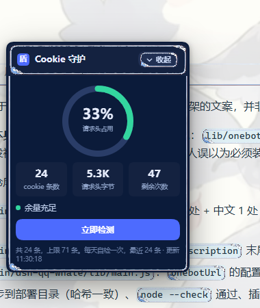

# Cookie 守护 · dsh-cookie-guard



DeepSeek Harness 桌面版的一个小浮窗插件：**实时显示登录 cookie 攒了多少条、请求头占了 16 KiB 上限的百分之几、还能再启动几次**。每天自动留一次快照，接近上限就变黄变红提醒清理。

- 只读，不碰 cookie 内容，不发网络请求，不清理任何东西。
- 浮窗可拖动、可折叠成小胶囊，位置会记住。

## 它解决什么问题

DSH 桌面版每次启动都会打开一个**随机端口**的本地 Host（`--port 0`），Host 在根请求上用 `303 + Set-Cookie` 发一条名为 `dsh-auth-<sha256("127.0.0.1:<端口>")>` 的登录 cookie。桌面外壳用 Chromium 的持久 cookie jar 收下它，**并且从不删除**。

于是：

| 项目 | 数值 |
| --- | --- |
| 每条 cookie 在请求头里占 | `dsh-auth-` + 43 字符名 + `=` + 173 字符值 + `; ` = **228 字节** |
| Node 默认 `maxHeaderSize` | **16384 字节** |
| 攒到第几条就爆 | `16384 / 228 ≈ 71.86` → **第 72 次启动** |

到那时 Host 的根请求在 Node 层就被 `431 Request Header Fields Too Large` 挡掉，桌面上表现为启动时弹 **`desktop welcome: Web authentication failed`**，也就是常说的「DSH 打不开了」。数据不会丢，清掉 cookie 库重新登录即可恢复。

这个插件就是给这条曲线装了个仪表盘：不用等到打不开，随时能看到自己离 72 还有多远。

## 安装

```sh
dsh plugin add github:3150481853/dsh-cookie-guard
```

装好后 DSH 首页右下角会出现浮窗（不需要重启）。

## 界面

- **环形仪表**：请求头占用百分比。低于 50% 绿、50%~71 黄、71 及以上红。
- **三格数字**：cookie 条数 / 请求头字节 / 还能启动几次。
- **立即检测**：立刻重新读一次库（平时 60 秒内复用缓存，避免反复扫全机句柄表）。
- **收起**：折叠成胶囊，只留一个百分比。胶囊也能拖，点一下展开。
- **拖动**：按住标题栏拖到任意位置，位置记在 `localStorage`，重新打开还在原处。

数据每 10 分钟自检一次；每个本地日期只保留一条快照，历史留 90 条，落在：

```
%USERPROFILE%\.dsh\cookie-guard\state.json
```

## 它怎么读到被锁的库

`Network/Cookies` 是 Chromium 的 SQLite 库，运行期间被 DSH 以独占方式打开——直接 `open()` 会拿到 `ERROR_SHARING_VIOLATION`，`esentutl`、复制、`SQLite backup API` 全部失败。

插件走的是 Windows 句柄表这条路：

1. `CreateToolhelp32Snapshot` 找到 `deepseek harness.exe` 的进程；
2. `NtQuerySystemInformation(SystemExtendedHandleInformation)` 枚举全局句柄表（这台机器上约 137 万个句柄，需要 64 MB 缓冲）；
3. 对目标进程 `OpenProcess(PROCESS_DUP_HANDLE)` + `DuplicateHandle` 复制每个候选句柄；
4. `GetFinalPathNameByHandleW` 比对路径，认准 `\network\cookies`（排除 `partitions\` 下平台登录用的那份）；
5. 在副本句柄上 `SetFilePointer(0)` + `ReadFile`，把库的字节读出来，再正则数 `dsh-auth-<43 位>` 去重。

一次约 240 ms，所以外面套了 60 秒缓存。

Node 本身没有 FFI，DSH 桌面版自带 koffi（`app.asar.unpacked/dsh/node_modules/koffi`，3.1.1），插件用 `createRequire` 直接加载它，不需要额外依赖、不需要编译。DSH 没在运行时则直接读文件，更快。

> 注意：`Cookie` 请求头里数不出来。桌面外壳通过 IPC 转发页面请求时只注入当前这一次启动的那一条 cookie，jar 里历史积累的那些从不出现在渲染进程中——所以只能读库。

## 桌面版自查工具（`desktop/`）

同一套读库逻辑的独立版本，不依赖 DSH，双击就能用：360×520 无边框圆角窗口、环形仪表、可复制清理命令。

- 源码：`desktop/dsh_cookie_ui.py`（Python 3.10 + tkinter + Pillow），`desktop/make_icon.py` 生成图标
- 已打包的 `DSH Cookie 检查.exe` 见仓库 Releases

## 数据与隐私

- 只用 `probe.js` 读本地 cookie 库的**字节流**，不对内容做任何解析或外发；计数用的正则只看名字。
- 服务端的接口是本地路由 `/dsh-cookie-guard/api`，委托给宿主的 `connection.requestRejection` 做同源/loopback 校验，跨站拿不到。
- 状态文件只有日期、条数、字节数。

## 兼容性 / 限制

- **仅 Windows**：句柄表这套是 Win32 API。
- 只读 DSH **桌面版**的库（`%APPDATA%\@deepseek-ai\dsh-desktop\Network\Cookies`）。
- 读不到就是读不到：借句柄失败时界面显示「读不到 cookie 库：<原因>」，不会猜一个数字糊弄过去。

## 开发

```sh
dsh plugin add github:3150481853/dsh-cookie-guard     # 从仓库装
```

改完源码后 Host 会热加载服务端；客户端 `client.js` 的改动也会自动热更新，一般不用重启。

## English

A floating health meter for DeepSeek Harness desktop. Every launch spawns the local Host on a random port and mints one more `dsh-auth-<hash>` cookie; each costs 228 bytes of request header and nothing ever deletes them, so around the 72nd launch the header crosses Node's 16 KiB `maxHeaderSize`, the Host answers `431`, and the app dies with `desktop welcome: Web authentication failed`.

The plugin reads the Chromium cookie jar while DSH is running — by duplicating an already-open file handle through `NtQuerySystemInformation` + `DuplicateHandle`, using the koffi FFI that ships inside DSH — and shows the count, header bytes, and launches remaining, with a daily snapshot and a red warning as you approach the limit.

Read-only, Windows only, no network calls.

MIT.
